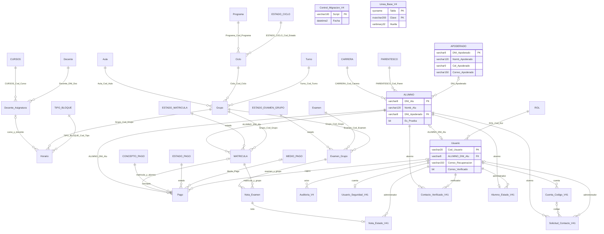

# Relaciones de Fractales Academy V4.3

Esquema resultante: 36 tablas y 41 claves foráneas. Se conservan las 25 tablas originales, las diez extensiones ya existentes y sus tipos. Se incorpora APODERADO como única tabla funcional nueva. Los catálogos de estado y las tablas de seguridad son parte del modelo aunque no todas tengan una pantalla propia.

`Control_Migracion_V4` y `Linea_Base_V4` son las dos tablas técnicas sin FK. Las notas tienen FK compuestas para asegurar que matrícula y simulacro pertenecen al mismo grupo. La FK de Pago a matrícula también protege la identidad del alumno. Una matrícula nueva no almacena ciclo/modalidad duplicados: se obtienen desde su grupo y ciclo.

`DNI_Apoderado` sigue siendo nullable para conservar estudiantes antiguos sin ese documento. Toda nueva alta V4.3 exige un apoderado identificado. El parentesco se conserva en ALUMNO porque corresponde a la relación con ese estudiante. Las columnas antiguas de nombre/celular/correo del apoderado se conservan y sincronizan mediante triggers, evitando pérdida de datos o ruptura de clientes anteriores.

El inventario y las definiciones efectivas se revisan con `00_DIAGNOSTICO.sql` y `99_VERIFICAR.sql`. La presencia de una tabla adicional en una base existente exige revisar sus FK antes de eliminar registros; la API inspecciona las relaciones reales y bloquea dependencias no contempladas.
