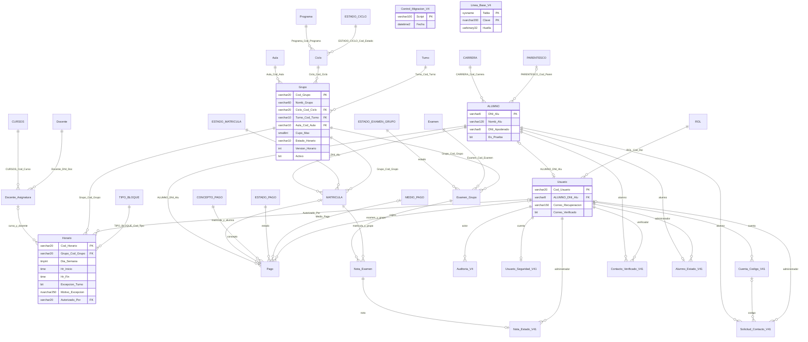

# Relaciones de Fractales Academy V4.4

35 tablas y 41 claves foráneas en el esquema estándar, comprobadas en SQL Server local. El diagrama incluye los catálogos y las seis tablas de seguridad V4.1. Las dos tablas técnicas sin FK aparecen como entidades independientes.

Grupo es la cabecera del horario académico y Horario contiene sus bloques. Matrículas y simulacros conservan las mismas claves. Modalidad y fechas se obtienen de Ciclo; no se duplican en cada bloque. Las FK compuestas de Nota_Examen garantizan la pertenencia al mismo conjunto; la FK compuesta de Pago protege al alumno de la matrícula.

El contacto de apoderado permanece en ALUMNO: DNI sin FK ni UNIQUE, nombre/celular/correo opcionales y parentesco mediante FK nullable. APODERADO ya no existe; su respaldo histórico se conserva en Auditoria_V4. La nueva FK Horario.Autorizado_Por identifica al administrador que autoriza una excepción de turno.

Unicidad publicada: ciclo + turno + aula, con Activo=1 y Estado_Horario=PUBLICADO. Los borradores no reservan recursos. No se introduce ON DELETE CASCADE. Consultar 00 y 05 de sql/migrations/v4_4 para inventario efectivo, nombres de restricciones y extensiones particulares de la base.
